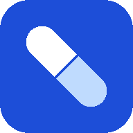

<div align="center">

<a href="public/icons/icon-512.png"></a>

# Planeador de Medicação · 用药小助手

**Tomas de hoje, lembretes no telemóvel, leitura da caixa com a câmara e sincronização com o NAS da família.**

[](https://github.com/mwmiao/Medicine-Planner/actions/workflows/docker.yml)
[](https://hub.docker.com/r/eazyeight/medicine-planner)

Português europeu · 简体中文

</div>

---

Aplicação web (PWA) simples e bilingue — **português europeu** e **chinês simplificado** — para ajudar uma pessoa idosa a tomar os medicamentos a horas, no iPhone, a partir de um atalho no ecrã principal. Os dados ficam no telemóvel e, se quiser, no seu próprio servidor (NAS).

## Funcionalidades

- **Hoje:** as tomas do dia com botões grandes — **"Já tomei"** e **"Adiar 15 min"**.
- **Dados no telemóvel:** tudo é guardado em IndexedDB (Dexie.js). Não há login.
- **Sincronização com o NAS:** opcional, sem contas, com um código. Junta as cópias do Safari e do ecrã principal sem perder tomas.
- **Lembretes Web Push:** enviados a partir do NAS, mesmo com a app fechada (iOS 16.4+, app no ecrã principal).
- **Fotografar a caixa:** texto em português (OCR com Tesseract.js) e código de barras EAN-13 / DataMatrix, no próprio telemóvel.
- **INFARMED / INFOMED:** liga cada medicamento ao registo oficial, com fonte e data.
- **Informação do medicamento:** indicações do médico, folheto, notas e avisos de segurança, sempre editáveis.
- **Cópia de segurança:** exportar e importar JSON, e histórico de versões no NAS.
- **Bilingue e acessível:** pt-PT e 中文, três tamanhos de texto, funciona offline depois da primeira utilização.

> ⚠️ Esta informação é apenas para referência. Siga sempre as indicações do seu médico ou farmacêutico.

## Instalar com Docker Compose

A cada push para `main`, o GitHub Actions (`.github/workflows/docker.yml`) corre os testes, gera a app e publica a imagem `eazyeight/medicine-planner:latest` (amd64 e arm64) no Docker Hub. São precisos os segredos `DOCKERHUB_USERNAME` e `DOCKERHUB_TOKEN` no repositório.

Exemplo de `docker-compose.yml` no NAS:

```yaml
services:
  medicine-planner:
    image: eazyeight/medicine-planner:latest
    container_name: medicine-planner
    ports:
      - "1380:1380"
    environment:
      # Código longo e aleatório (ex.: `openssl rand -hex 16`). Sem ele, a sincronização e os lembretes ficam desligados.
      SYNC_CODE: "troque-por-um-codigo-longo-e-aleatorio"
      # Opcional: contacto exigido pelo Apple nas chaves VAPID (mailto: ou https:).
      # VAPID_SUBJECT: "mailto:o-seu-email@exemplo.pt"
    volumes:
      - medicine-planner-data:/data
    restart: unless-stopped
    labels:
      - com.centurylinklabs.watchtower.enable=true

volumes:
  medicine-planner-data:
```

```bash
docker compose up -d
```

Abra `http://IP-do-NAS:1380`. Se usar uma pasta do NAS em vez de um volume (`./data:/data`), dê-lhe permissões ao utilizador 1000 (`chown 1000:1000 data`), porque o servidor não corre como root.

**Importante — HTTPS:** no iPhone, a câmara (`getUserMedia`), o service worker (funcionamento offline) e as notificações só funcionam em **HTTPS**. Através de `http://IP-do-NAS:1380` a app abre, mas fica sem modo offline e usa "Escolher da galeria" em vez da câmara ao vivo. Coloque o contentor atrás de um proxy reverso com certificado válido (ex.: proxy reverso do Synology/QNAP com Let's Encrypt, Nginx Proxy Manager, Caddy ou Cloudflare Tunnel).

### Atualizações automáticas (Watchtower)

A etiqueta `com.centurylinklabs.watchtower.enable=true` faz o Watchtower atualizar o contentor quando aparece uma nova imagem `latest`.

### Alternativa: Vercel

A app é **100 % estática** (`output: "export"`), por isso pode ser alojada em qualquer serviço gratuito, mas **sem** sincronização nem lembretes (precisam do servidor do NAS).

1. Coloque o projeto num repositório GitHub e, em <https://vercel.com>, escolha **Add New… → Project**.
2. Deixe as opções detetadas (Framework: Next.js; Build Command: `npm run build`) e clique em **Deploy**.

Alternativas: Netlify ou Cloudflare Pages (pasta de publicação: `out`, comando: `npm run build`).

## Segurança

- A sincronização usa um único **código de sincronização** (`SYNC_CODE`), sem contas. O servidor bloqueia um endereço após 10 códigos errados em 15 minutos; atrás de um proxy reverso, só passa a ser por cliente (em vez de bloquear todos) com `TRUST_PROXY=1`.
- O código viaja em cada pedido, por isso **use sempre HTTPS** fora de casa.
- A fotografia da caixa **não é guardada**: fica só na memória durante a leitura, e só sai do telemóvel se `ANTHROPIC_API_KEY` estiver ativa.
- Para expor o NAS à internet, prefira um túnel ou proxy com controlo de acesso (ex.: Cloudflare Tunnel com Cloudflare Access).
- Com `AUTO_CONNECT=1` o código de sincronização deixa de ser um segredo para quem chega ao endereço da app; não o ative num endereço público sem controlo de acesso.
- Com `ANTHROPIC_API_KEY`, as páginas do folheto fotografadas ou coladas são enviadas à Anthropic para tradução; a fotografia da caixa, quando a IA está ativa, também é enviada à Anthropic e não é guardada. O pedido exige o código de sincronização; a chave nunca sai do servidor.
- Para as instruções automáticas, o **nome do medicamento** (sem dados pessoais) é enviado à Anthropic e ao openFDA (`api.fda.gov`).

## Guardar os dados no NAS (sincronização)

No iPhone, o Safari e a app adicionada ao ecrã principal têm **armazenamento separado**: o que se escreve num não aparece no outro. O mesmo acontece com endereços diferentes (IP, nome, http/https). Para os dados nunca se perderem, a imagem Docker inclui um pequeno servidor (`server/server.mjs`, Node + a biblioteca `web-push`) que:

- serve a app (como o nginx fazia: cache, 404, redirecionamentos relativos);
- guarda os dados em `/data/medicine-planner.json` (volume), com escrita atómica;
- mantém as últimas 50 versões em `/data/history/` (`HISTORY_KEEP` para mudar);
- exige o **código de sincronização** (`SYNC_CODE`).

No telemóvel: **Definições → Guardar no NAS** → escrever o código → **Ligar ao NAS**. Faça isto em **cada** sítio onde a app é usada (Safari e ecrã principal): a primeira ligação **junta** os dados de ambos. Depois a app:

- continua a funcionar sem rede (os dados ficam também no telemóvel);
- sincroniza ao abrir, ao voltar à app, quando a rede volta, a cada minuto e logo depois de cada alteração;
- junta alterações dos dois lados: ganha a mais recente, apagar não "ressuscita", e **uma toma marcada como tomada nunca é substituída por "adiada"** (só "Desfazer" a remove) — para evitar doses a dobrar.

## Cópia de segurança e restauro

| O que quer fazer | Como |
| --- | --- |
| Guardar uma cópia | **Definições → Exportar dados** (ficheiro JSON) |
| Restaurar uma cópia | **Definições → Importar dados** (substitui os dados atuais, com confirmação) |
| Apagar tudo | **Definições → Apagar todos os dados** (com dupla confirmação) |
| Recuperar uma versão antiga do NAS | Copie um ficheiro de `/data/history/` para `/data/medicine-planner.json` com o contentor parado |

"Importar dados" e "Apagar todos os dados" substituem também a cópia do NAS.

## Instalar como app (PWA)

### iPhone

1. Abra o endereço da app no **Safari** (tem de ser o Safari).
2. Toque no botão **Partilhar** (quadrado com uma seta para cima).
3. Escolha **"Adicionar ao ecrã principal"**.
4. Toque em **"Adicionar"**. Aparece o ícone azul **"Planeador"**.

A partir daí a app abre em ecrã inteiro, sem barra do Safari, e funciona sem internet. As mesmas instruções estão em **Definições** dentro da app, nas duas línguas.

## Lembretes (Web Push a partir do NAS)

Os lembretes chegam **mesmo com a app fechada e o ecrã bloqueado**. Como funciona:

1. A app tem de estar **adicionada ao ecrã principal** (iOS 16.4 ou mais recente) e **ligada ao NAS** (secção acima).
2. Em **Definições → Lembretes no telemóvel** aparece o botão grande **"Ativar lembretes"** — **só** quando a app está aberta a partir do ícone do ecrã principal. A permissão de notificações é pedida apenas quando se toca nesse botão (regra do iOS).
3. A app cria uma subscrição Web Push com as chaves **VAPID** do NAS e envia ao NAS: a subscrição, o horário dos medicamentos, o fuso horário, o idioma, e a lista de lembretes dos próximos **30 dias** já com o texto em pt-PT ou zh-CN (nome do medicamento, dose e hora).
4. No NAS, um "cron" corre **a cada minuto** (dentro do servidor; também existe `POST /api/cron/tick` para um cron externo) e envia os lembretes que chegam à hora. Tocar no lembrete abre a app no ecrã **Hoje**.
5. Se a toma já foi marcada como tomada (dados sincronizados), o lembrete não é enviado. Ao adiar 15 min, o lembrete passa para a nova hora.
6. Subscrições expiradas ou recusadas pelo serviço de push são removidas automaticamente. Falhas temporárias são repetidas no minuto seguinte.
7. **"Enviar lembrete de teste"** em Definições confirma que tudo funciona.

A lista é renovada sempre que a app abre ou algo muda; abra a app **pelo menos uma vez por mês**.

Variáveis do contentor:

| Variável | Para quê |
| --- | --- |
| `SYNC_CODE` | Obrigatória para sincronização e lembretes |
| `VAPID_SUBJECT` | Contacto `mailto:`/`https:` enviado ao serviço de push (por omissão, o repositório no GitHub) |
| `VAPID_PUBLIC_KEY`, `VAPID_PRIVATE_KEY` | Opcional; sem elas, são geradas uma vez e guardadas em `/data/push.json` |
| `CRON_SECRET` | Opcional; permite chamar `POST /api/cron/tick` de fora com `Authorization: Bearer …` |
| `TRUST_PROXY=1` | Opcional; atrás de um proxy reverso, conta as tentativas erradas por cliente (cabeçalho `X-Forwarded-For`) em vez de bloquear todos. Só ative se o proxy for o único caminho até ao contentor |
| `INTERNAL_CRON=off` | Desliga o "cron" interno (se usar um externo) |
| `AUTO_CONNECT=1` | Opcional; a app liga-se sozinha ao NAS (o servidor entrega o código em `GET /api/connect`, sem o utilizador escrever nada). **Quem conseguir abrir o endereço da app recebe o código e todos os dados** — use só se o endereço for privado (rede de casa, VPN ou atrás de Cloudflare Access) |
| `ANTHROPIC_API_KEY` | Opcional; liga a tradução do folheto para chinês e a leitura da fotografia da caixa. A chave fica só no servidor. Os textos/fotografias do folheto são enviados à Anthropic; não contêm dados pessoais. |
| `AI_MODEL` | Opcional; modelo a usar (por omissão `claude-sonnet-5-5`). Há um limite de 60 pedidos por hora. |

**Instruções automáticas em chinês:** quando um medicamento ainda não tem informação e a IA está ativa, o servidor pede à Claude a substância ativa (nome em inglês), vai buscar a etiqueta pública da mesma substância à base de dados de domínio público **openFDA** (`api.fda.gov`) e a Claude resume-a em chinês simplificado. É uma etiqueta dos EUA, **não** o folheto português: a app avisa disso e mostra a ligação à fonte (DailyMed). Se não houver etiqueta, não se inventa nada; a app sugere fotografar o folheto. O indice.eu e o INFOMED **não** são usados de propósito (termos de utilização / robots).

**Rede:** o NAS precisa de acesso à internet **de saída** (para o serviço de push da Apple). O telemóvel precisa de chegar ao NAS por **HTTPS** para ativar os lembretes e sincronizar; o envio dos lembretes não precisa que o telemóvel esteja em casa.

**Alternativa sem NAS:** enquanto a app está aberta, mostra uma faixa e faz um som à hora da toma. Para iPhones antigos, use os alarmes do iPhone (**Relógio → Alarmes**) ou **Atalhos → Automação → Hora do dia → Abrir app** — as instruções estão em Definições.

Não são usadas funcionalidades que exijam certificado de programador iOS, App Store ou notificações nativas.

## Fotografar a caixa (OCR e código de barras)

A app ajuda a **identificar** o medicamento; nunca sabe a receita do médico. A dose e o horário são sempre os que o utilizador escreve ou confirma.

- Usa a câmara traseira com `getUserMedia` (com retângulo-guia), a câmara nativa do iPhone, ou uma fotografia da galeria (`<input type="file" accept="image/*" capture="environment">`).
- **OCR só em português / alfabeto latino** (`por`), num Web Worker do Tesseract.js. Não há OCR de chinês: letras de outros alfabetos são tratadas como ruído. Os acentos (ã, ç, é, ê, í, ó, ú) mantêm-se; as maiúsculas são usadas só para comparar; os nomes nunca são traduzidos.
- A fotografia é preparada (tamanho, contraste) e lida também rodada (90°/180°/270°), ficando a melhor leitura.
- **Código de barras** na mesma fotografia (biblioteca gratuita `@zxing`): prioridade ao **EAN-13**; também lê o **DataMatrix GS1** das caixas europeias (GTIN, validade, lote). O número é mostrado e verificado (dígito de controlo). Se já existir um medicamento guardado com o mesmo EAN, a app avisa. Um EAN **nunca** é usado sem confirmação do utilizador.
- Sugere: nome, substância ativa (DCI), dosagem, forma farmacêutica, unidades na caixa, validade, fabricante e EAN — tudo editável — e pesquisa logo no INFARMED.
- O texto lido completo fica numa secção recolhível **"Texto lido (em bruto)"** para conferir.
- Da **primeira vez** é preciso internet para descarregar o motor e o idioma (de cdn.jsdelivr.net). Depois ficam em cache.
- **A fotografia não é guardada.** Fica só na memória durante a leitura, pode ser apagada com "Apagar fotografia" e é libertada ao usar os dados.

## Pesquisa no INFARMED

### O que foi investigado

O **INFOMED** (<https://extranet.infarmed.pt/INFOMED-fo/>) é a base de dados nacional de medicamentos de uso humano do INFARMED. Permite pesquisar por nome do medicamento ou substância ativa (DCI) e tem uma pesquisa avançada (forma farmacêutica, dosagem, titular de AIM, estado, etc.).

Na investigação feita (outubro de 2026):

- **Não existe uma API pública e documentada** (JSON ou outra) para aplicações.
- O INFOMED é uma aplicação JSF (páginas `.xhtml`, formulários POST com estado de sessão). **A pesquisa não aceita parâmetros no URL**, por isso não é possível criar uma ligação direta para "resultados de pesquisa de X".
- Os URLs estáveis são:
  - Página inicial / pesquisa: `https://extranet.infarmed.pt/INFOMED-fo/index.xhtml`
  - Pesquisa avançada: `https://extranet.infarmed.pt/INFOMED-fo/pesquisa-avancada.xhtml`
  - Ficha de cada medicamento: `https://extranet.infarmed.pt/INFOMED-fo/detalhes-medicamento.xhtml?med_guid=<identificador>`
- Extrair dados do HTML ("scraping") seria frágil, e o site esteve indisponível (HTTP 503) para pedidos automáticos durante os testes. Por isso **a app não inventa endpoints nem dados**.

### O que a app faz

1. **"Pesquisar no INFARMED"** (no formulário, ou automaticamente depois de fotografar a caixa, com o nome lido ou o código de barras):
   - procura primeiro nos registos já guardados **neste telemóvel** — pelo **código de barras (EAN)** e depois pelo nome/substância (funciona offline);
   - mostra os resultados com nome comercial, substância ativa, forma farmacêutica, dosagem, estado da autorização, titular de AIM, ligação ao registo oficial e ao Folheto Informativo, com um botão **"Selecionar"**;
   - explica de forma simpática, nas duas línguas, que não há pesquisa automática.
2. **"Copiar nome e abrir INFARMED"** copia o nome e abre o INFOMED oficial. **"Ver no INFARMED"** abre o site.
3. **"Ligar ao registo oficial"**: o utilizador cola o endereço da ficha do medicamento (com `med_guid`) e copia os dados principais, bem como, se quiser, os endereços do **Folheto Informativo** e do **RCM**. A app só aceita endereços `https://…infarmed.pt`.
4. Ao selecionar, os campos do formulário são **pré-preenchidos, mas tudo continua editável**. O registo é guardado em cache no IndexedDB **com a data de obtenção**, e fica disponível offline e em pesquisas futuras.
5. Em todo o lado é mostrada a **fonte** e a **data**. Dados escritos pelo utilizador aparecem como "Introduzido manualmente (copiado do INFARMED)" ou "Escrito à mão", **nunca** como informação oficial gerada automaticamente.

Quando não há resultado, aparece uma mensagem amigável nas duas línguas, com as opções de abrir o INFARMED ou **escrever os dados à mão**. O medicamento pode ser guardado na mesma.

Se no futuro existir uma API, basta implementar a interface `InfarmedProvider` (`src/lib/infarmed/provider.ts`) e chamá-la com `setDefaultProvider(...)`, se necessário através de uma pequena rota/proxy por causa de CORS.

## Informação do medicamento

Cada medicamento tem uma secção **"Ver informação"** (recolhível), com estes blocos separados:

- **Indicações do médico**: dose, horário e instruções escritas no formulário.
- **Informação oficial / folheto**: para que serve, como tomar, se se esquecer de uma toma, efeitos secundários, avisos e conservação. Tudo editável, com a fonte (INFARMED, folheto informativo, caixa, ou escrito à mão) e a data da última alteração.
- **Lido da caixa (fotografia)**: o que o OCR encontrou.
- **Notas pessoais**.

Regras de segurança fixas: se não houver orientação para uma toma esquecida aparece *"Se se esquecer de uma toma, siga as instruções da embalagem ou pergunte ao seu médico ou farmacêutico. Não tome uma dose a dobrar."*, e é sempre mostrado o aviso de sinais urgentes (dificuldade em respirar, inchaço da cara ou garganta → 112). A app **não gera** posologias, interações, contraindicações nem efeitos secundários. O texto é mostrado tal como foi escrito (a app não traduz automaticamente informação médica).

## Desenvolvimento

Requisitos: **Node.js 20 ou superior** e npm.

```bash
npm install
npm run dev
```

Abra <http://localhost:3000>. Para experimentar no iPhone na mesma rede Wi-Fi, use o endereço IP do computador (ex.: `http://192.168.1.20:3000`). A câmara (`getUserMedia`) só funciona em **HTTPS** ou em `localhost`; em HTTP simples a app usa automaticamente a alternativa "Escolher fotografia".

| Comando | O que faz |
| --- | --- |
| `npm run build` | Gera a versão estática final na pasta `out/` |
| `npm start` | Serve a pasta `out/` com o servidor do NAS (`SYNC_CODE=… npm start` liga a sincronização) |
| `npm test` | Corre os testes (Vitest + fake-indexeddb) |
| `npm run typecheck` | Verifica os tipos TypeScript |
| `npm run icons` | Volta a gerar os ícones PNG em `public/icons/` |

### Estrutura do projeto

```
src/
  app/                    páginas (Hoje, Histórico, Medicamentos, Novo/Editar/Ver, Definições)
  components/             componentes pequenos e reutilizáveis (DoseCard, MedicationForm,
                          BoxScanner, InfarmedPanel, MedicalInfoSection, ConfirmDialog, …)
  lib/
    db.ts                 base de dados Dexie (IndexedDB)
    schedule.ts           geração das tomas do dia, estados, próxima toma
    doses.ts              marcar como tomado / adiar / desfazer
    medications.ts        criar, editar, validar, apagar
    backup.ts             exportar / importar JSON
    infarmed/             URLs oficiais, fornecedor (interface) e pesquisa + cache
    ocr/                  Tesseract.js (português) e heurísticas de leitura da caixa
    barcode/              EAN-13 / DataMatrix GS1 (@zxing) e validação
    sync/                 sincronização com o NAS (junção segura das cópias)
    reminders/, push.ts   lista de lembretes e subscrição Web Push
    i18n/                 textos pt-PT e zh-CN (o chinês é verificado pelo TypeScript)
server/                   servidor do NAS: app, dados (/data) e lembretes Web Push
public/
  manifest.webmanifest, sw.js (offline + notificações push), icons/
scripts/                  geração de ícones e ajuste pós-build da exportação estática
tests/                    testes Vitest
```

### Notas técnicas

- Next.js 16 (App Router), React 19, TypeScript estrito (sem `any`), Tailwind CSS 4.
- O modo de texto (normal / grande / muito grande) muda o tamanho da fonte da raiz; toda a interface usa `rem`.
- A interface respeita as margens seguras do iPhone (notch / Dynamic Island) com `env(safe-area-inset-*)`.
- `scripts/postbuild-export.mjs` corrige os nomes dos ficheiros de pré-carregamento da exportação estática do Next.js 16, para a navegação funcionar em qualquer alojamento estático e offline.

## Licença

Projeto pessoal.
